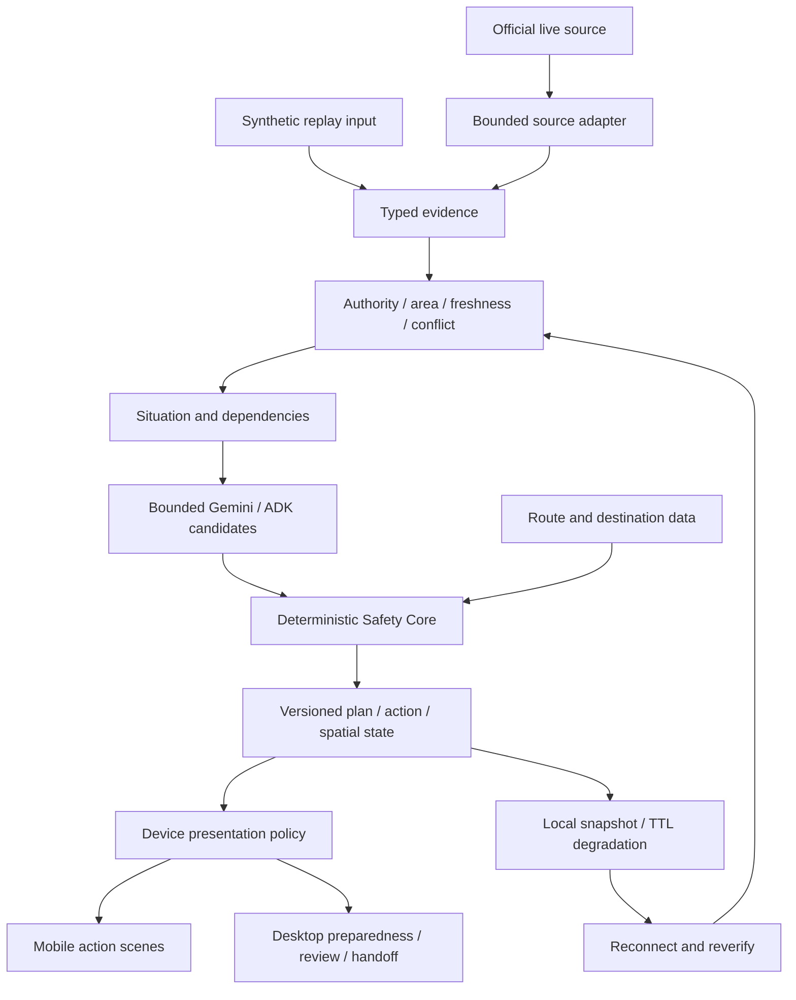

# 72H Architecture v0.2

## Authorized P1 architecture

P1 extends the existing pipeline with separate live-source intake and device
presentation; it must not create a second safety engine per device. The source
adapter validates external payloads before typed evidence enters situation and
plan evaluation. Candidate geometry is mobility data; eligibility requires
separate source, scope, conflict, freshness and destination checks.



Live and replay state must remain distinguishable throughout the API, local
cache and UI. No adapter failure, cached route or physical network restoration
may grant movement eligibility. Current implementation and acceptance status:
[VNEXT_P1_VALIDATION.md](VNEXT_P1_VALIDATION.md).

## vNext P0 read-projection extension

The authorized P0 extension retains the backend evidence, Gemini/ADK and Safety
Core pipeline. `apps/web/lib/vnext.ts` derives severity/authority/notifications
and reduces local check-in state deterministically from schema-validated public
snapshots. It cannot publish plans or assign source trust. `continuity.ts` still
degrades cached actions and adds deadline-driven expiration independent of power
mode refresh frequency.

MapLibre selects a bounded app-owned OpenStreetMap road extract from an installed
pack catalog using coordinates, with profile reference pins and viewport derived
from configuration. Uncovered regions remain explicitly unsupported. A manifest
validates bytes/SHA-256, feature count, geographic extent, capture timestamp and
license. The Service Worker precaches the map, worker modules and application
shell. Map data never enters trusted disaster evidence. No remote tiles, fonts,
Overpass calls or maps API secrets are required at runtime.

Safety checks, notification ledgers and power preference persist locally with
schema validation. Explicit storage consent can retain one last browser position
with accuracy and capture time, never a location history. Restore/offline/aging
show LAST_KNOWN_LOCATION. Location is an optional single foreground fix. Low-power
modes stop noncritical POST/replay work,
and SURVIVAL removes map rendering. Timers remain foreground best effort. See
[VNEXT_P0_CONTRACTS.md](VNEXT_P0_CONTRACTS.md) and
[VNEXT_VALIDATION.md](VNEXT_VALIDATION.md) for current acceptance evidence.

Canonical area IDs, a server-owned ancestry catalog, typed scoped assessments,
source area authorization and configurable replay profile seeds remove city-name
assumptions from severity/planning consumers. GPS never grants official scope.
The detailed follow-up contract is [VNEXT_AREA_LOCATION.md](VNEXT_AREA_LOCATION.md).

## 1. Architecture Goals

72H must support five properties:

1. **Evidence-backed planning** — important actions are tied to verified evidence.
2. **Agentic re-planning** — relevant situation changes can invalidate dependencies and trigger re-planning.
3. **Deterministic safety** — critical policy decisions are not delegated to free-form model reasoning.
4. **Offline continuity** — the application remains useful during temporary network loss.
5. **Credential isolation** — no privileged credential is exposed to the browser, Git repository, or offline storage.

## 2. High-Level Architecture

```text
                         ┌──────────────────────┐
                         │      72H Web App     │
                         │ Next.js / TypeScript │
                         └──────────┬───────────┘
                                    │
                              HTTPS │ no secrets
                                    ▼
                         ┌──────────────────────┐
                         │      Cloud Run       │
                         │   FastAPI Backend    │
                         └──────────┬───────────┘
                                    │
                    Service Identity / ADC
                                    │
         ┌──────────────────────────┼──────────────────────────┐
         ▼                          ▼                          ▼
 ┌────────────────┐        ┌────────────────┐        ┌────────────────┐
 │ Vertex AI      │        │   Firestore    │        │ Secret Manager │
 │ Gemini + ADK   │        └────────────────┘        └───────┬────────┘
 └───────┬────────┘                                           │
         │                                                    ▼
         │                                           Third-party secrets
         ▼
 ┌─────────────────────────────────────────────────────────────┐
 │ Agent Runtime                                               │
 │ Situation Agent / Source Agent / Mobility Agent / Action   │
 └──────────────────────────────┬──────────────────────────────┘
                                ▼
                     ┌──────────────────────┐
                     │ Deterministic Safety │
                     │        Core          │
                     └──────────┬───────────┘
                                │
              ┌─────────────────┼──────────────────┐
              ▼                 ▼                  ▼
         Cloud Logging     External Sources      Replay
                                                Fixtures


                      Browser Local Continuity
                      ─────────────────────────

                      ┌──────────────────────┐
                      │    Service Worker    │
                      └──────────┬───────────┘
                                 │
                      ┌──────────▼───────────┐
                      │      IndexedDB       │
                      │ Situation / Evidence │
                      │ Plans / Trace / Pack │
                      │      NO SECRETS      │
                      └──────────────────────┘
```

## 3. Frontend

Recommended stack:

- Next.js
- TypeScript
- Tailwind CSS
- PWA Service Worker
- IndexedDB

Primary responsibilities:

- user onboarding
- situation dashboard
- plan visualization
- source inspection
- agent trace visualization
- replay controls
- connectivity status
- Offline Emergency Pack

The frontend must be able to open the critical emergency dashboard from cached assets after an initial successful load.

### Frontend security boundary

The browser must never receive:

- Gemini or Vertex AI credentials
- Google Cloud service-account keys
- Secret Manager values
- transport-provider API keys
- privileged OAuth refresh tokens

Any `NEXT_PUBLIC_*` variable is treated as public information.

## 4. Backend

Recommended stack:

- Python
- FastAPI
- Google Agent Development Kit
- Gemini through Vertex AI
- Cloud Run

Responsibilities:

- normalize external events
- coordinate agents
- maintain cloud situation state
- validate candidate plans through the Safety Core
- persist evidence and plans
- produce structured trace events
- serve replay events
- call third-party APIs without exposing their credentials

## 5. Google Cloud Authentication

Production Google Cloud authentication uses a dedicated Cloud Run runtime service account and Application Default Credentials.

Expected flow:

```text
Cloud Run
↓
72H runtime service account
↓
Application Default Credentials
↓
Vertex AI / Firestore / Logging / Secret Manager
```

Production must not depend on a checked-in service-account JSON key.

A suggested runtime identity is:

```text
h72-runtime@PROJECT_ID.iam.gserviceaccount.com
```

Grant only the permissions required by the shipped implementation. Do not grant broad Owner or Editor access.

## 6. Third-Party Secrets

Third-party credentials are stored in Google Secret Manager and are read only by the backend runtime.

Examples:

- transport provider API token
- partner API credential
- other external service keys

Secret values must never be persisted to Firestore, replay fixtures, browser storage, or logs.

See `SECURITY_AND_SECRETS.md`.

## 7. Agent Layer

### Situation Agent

Purpose:

> What is the current situation and what changed?

Produces:

- situation summary
- semantic change summary
- uncertainties
- request for plan review

It cannot override source trust or plan validity.

### Source Agent

Purpose:

> What claims exist in this external information?

It produces normalized evidence candidates. Trust classification remains deterministic.

### Mobility Agent

Purpose:

> Which transport options currently appear available?

The planned production-facing mobility provider is the **駅すぱあと API MCP Server**.

Responsibilities of this integration include obtaining supported route/transport candidate information for the Mobility Agent. The provider response is never treated as a disaster-safety verdict.

Expected flow:

```text
駅すぱあと API MCP Server
→ route / transport candidates
→ Mobility Agent normalization
→ verified disruption + disaster evidence
→ Deterministic Safety Core
→ movement action eligibility
```

The Mobility Agent must not label a route as safe. `AVAILABLE` means transport availability only.

### Action Agent

Purpose:

> Given eligible evidence and the current situation, what should the user see under NOW / NEXT / AVOID?

It produces candidate plans only.

## 8. Safety Core

The Safety Core is deterministic application logic rather than a free-form agent.

Responsibilities:

- evidence eligibility
- TTL / freshness
- conflict state
- plan expiration
- dependency invalidation
- high-risk action blocking
- hallucinated evidence-reference rejection
- replay state determinism
- offline degradation policy

See `AGENT_SAFETY_CONTRACT.md`.

## 9. Core Domain Objects

### UserProfile

```text
id
preferred_language
current_location
accommodation_location
current_destination
party_size
safety_status
```

### DisasterEvent

```text
id
type
occurred_at
affected_area
source
severity
received_at
```

### Evidence

```text
id
source
source_type
published_at
received_at
area
claims
trust
freshness
conflict
```

### Situation

```text
id
user_id
active_event_id
mobility_state
uncertainties
conflicts
network_state
updated_at
```

### Plan

```text
id
version
status
created_at
expires_at
based_on_evidence_ids
invalidation_reason
```

### PlanAction

```text
id
plan_id
category
text
reason
evidence_ids
risk
confidence
dependencies
status
```

### TraceEvent

```text
id
timestamp
agent
event_type
input_refs
output_refs
status
```

## 10. Firestore Collections

```text
users/
situations/
events/
evidence/
plans/
plan_actions/
agent_events/
replay_sessions/
```

Secrets are not domain objects and must not be stored in these collections.

## 11. External Data Adapter Pattern

```text
DisasterSource
├── JmaSource
├── SafetyTipsSource
└── ReplaySource

MobilitySource
├── ReplayMobilitySource
├── EkispertMcpSource
└── TransportStatusSource
```

`EkispertMcpSource` is the planned adapter for the Hackathon-provided **駅すぱあと API MCP Server**. `TransportStatusSource` represents current disruption/operational evidence when available. Route topology/candidates and current disruption evidence are kept conceptually separate so that route availability is never confused with route safety.

Current implementation boundary (2026-10-05): `EkispertMcpProvider` now lives in
`services/agent-api/agent_api/mobility`. It exposes bounded MCP discovery/calls
only; live normalization into eligible evidence and a separate Mobility Agent
are still pending. The synthetic source registry and Safety Core remain the
actual replay input path. See [EKISPERT_MCP.md](EKISPERT_MCP.md).

The 駅すぱあと access key is a third-party secret. It is read only by the backend runtime through Secret Manager in production and must never be exposed to the browser or committed to Git.

This allows the judging experience to remain reliable even if a production API is temporarily unavailable.

## 12. Replay Engine

Replay controls external event timing and input data only. Core safety and plan transitions must remain real.

Supported event types include:

```text
disaster_alert
official_update
transport_update
unverified_report
network_degraded
network_lost
network_restored
verified_update
plan_expiration
```

Core replay transitions must not depend on stochastic model output.

## 13. Network Architecture

### Online

```text
External Sources
↓
Cloud Run
↓
Agent Runtime + Safety Core
↓
Firestore
↓
Browser Sync
↓
IndexedDB Snapshot
```

### Offline

```text
No Network
↓
Local Situation Snapshot
+
Local Evidence Snapshots
+
Last Verified Plan
+
Offline Emergency Pack
↓
Local Safety Core
↓
Safe degraded UI
```

### Reconnect

```text
Connectivity restored
↓
RECONNECTING
↓
Fetch current evidence
↓
Reconcile
↓
Dependency evaluation
↓
Re-plan if needed
↓
ONLINE_VERIFIED
```

## 14. API Surface — Initial Proposal

```text
GET  /api/situation/{session_id}
POST /api/situation/{session_id}/evaluate
POST /api/events
GET  /api/evidence/{session_id}
GET  /api/plans/{session_id}
POST /api/plans/{session_id}/evaluate
GET  /api/trace/{session_id}
POST /api/replay/start
POST /api/replay/pause
POST /api/replay/next
POST /api/replay/reset
GET  /api/replay/{session_id}
```

## 15. Deployment

Initial deployment:

```text
Frontend + API: Cloud Run
Database: Firestore
Agent runtime: Google ADK + Gemini through Vertex AI
Authentication: Cloud Run service identity / ADC
Third-party secrets: Secret Manager
Observability: Cloud Logging
```

A split frontend/backend deployment may be introduced later if operationally useful.

## 16. Observability

Every important state transition should generate:

1. a user-safe trace event for `/trace`
2. a structured operational log for debugging

Important events include:

- `DISASTER_EVENT_RECEIVED`
- `EVIDENCE_NORMALIZED`
- `EVIDENCE_VERIFIED`
- `SITUATION_CHANGED`
- `PLAN_GENERATED`
- `PLAN_INVALIDATED`
- `REPLAN_TRIGGERED`
- `UNVERIFIED_SOURCE_REJECTED`
- `NETWORK_DEGRADED`
- `OFFLINE_MODE_ENTERED`
- `NETWORK_RESTORED`

Logs must not contain API keys, access tokens, authorization headers, or Secret Manager payloads.

## 17. Security Boundaries

- external content is always untrusted data
- agent output cannot directly override source trust
- agent output cannot directly override plan validity
- tool access is role-limited by agent
- important actions require evidence IDs
- Google Cloud access uses service identity / ADC
- third-party credentials stay in Secret Manager
- the frontend contains no privileged secrets
- IndexedDB contains no privileged secrets
- sensitive configuration never enters the repository

See `SECURITY_AND_SECRETS.md`.

## 18. MVP Build Order

### Phase 1 — Domain and Replay

1. repository structure
2. core schemas
3. replay event model
4. situation state
5. evidence state
6. plan model

### Phase 2 — Deterministic Safety

7. trust states
8. freshness TTL
9. dependency invalidation
10. plan versioning
11. network state machine

### Phase 3 — Agent Layer

12. Source Agent
13. Situation Agent
14. Action Agent
15. Mobility Agent

### Phase 4 — UI

16. dashboard
17. plan history
18. sources
19. trace
20. demo controls

### Phase 5 — Offline Continuity

21. Service Worker
22. IndexedDB
23. Emergency Pack
24. Last Verified Plan
25. reconnect reconciliation

### Phase 6 — Security and Cloud Integration

26. dedicated Cloud Run runtime service account
27. Vertex AI / Gemini authentication via ADC
28. Secret Manager integration for third-party credentials
29. `.gitignore` / `.env.example` secret hygiene
30. rate limits and budget safeguards

### Phase 7 — Submission

31. Cloud Run deployment
32. replay stability tests
33. safety and secret-audit tests
34. architecture diagram
35. demo video
36. submission README

## 19. Architecture Definition of Done

Normal mode:

```text
Verified event
→ Situation
→ Candidate Plan
→ Safety Validation
→ Active Plan
→ Relevant change
→ Invalidation
→ Re-plan
```

Continuity mode:

```text
Network lost
→ Last Verified Plan retained
→ Evidence freshness continues locally
→ Live-dependent actions degrade safely
→ Network restored
→ Reconcile
→ Re-evaluate
```

Credential mode:

```text
Browser
→ no secrets

Cloud Run
→ service identity / ADC
→ Google Cloud services

Cloud Run
→ Secret Manager
→ third-party APIs

Git / IndexedDB / Logs
→ no secrets
```

All three flows are part of the architectural core of 72H.
